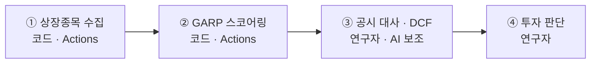

# Asia GARP Research

아시아 5개 시장에서 성장과 가격을 함께 고려해 **조사할 기업의 우선순위**를 만드는 독립 리서치 프로젝트입니다.

*An AI-assisted equity research engine for ranking research candidates across Korea, Japan, mainland China, Hong Kong and Taiwan. Investment decisions remain human-led.*

**30초 요약.** 라이브 목록 수집에서 **16,629개 종목 코드**를 확인했습니다. 별도 정적 재생에서는 유효 재무 데이터 **500건** 중 **439개**가 점수화됐습니다. 기존 등록 종목 DB하이텍은 **2위 · 77.15점**이었고, 후속 공시·DCF 연구에서는 **안전마진을 입증하지 못해 신규 편입을 보류**했습니다.

[DB하이텍 리서치 PDF](case-studies/db-hitek/db-hitek-equity-research-2026-11-20.pdf) · [실행·선정 근거](case-studies/db-hitek/screening_evidence.md) · [파이프라인 코드와 구조](docs/PORTFOLIO_RUNBOOK.md#파이프라인-코드) · [설치·실행·테스트](docs/PORTFOLIO_RUNBOOK.md#로컬-실행)

| 제공하는 것 | 결과를 해석할 때 |
|---|---|
| 시장별 상장 출처와 수집 실패 기록 | 수집 코드는 고유 기업 수나 거래소 전체 목록를 뜻하지 않습니다. |
| 데이터 충족률과 품질 경고를 갖춘 GARP 연구 순위 | 공급자 재무 정의와 업종 분류에는 미해결 항목이 있습니다. |
| 공시 및 별도 DCF를 이용한 후속 검증 사례 | 투자수익 백테스트와 투자성과 검증은 수행하지 않았습니다. |

## 실제 실행 근거

| 실행 | 데이터 모드와 관측 | 범위 |
|---|---|---|
| **A · [Actions #44370844839](https://github.com/godtang-blip/ai-quant-asia-garp-research/actions/runs/44370844839)** | 2026-11-19 KST 라이브 `discovery_only`. 5개 시장 **16,629개 종목 코드**. | 상장 목록만 수집. 재무 조회와 점수화는 실행하지 않음. [출처·누락 범위](docs/FIVE_MARKET_DISCOVERY_MILESTONE.md) |
| **B · [DB하이텍 선정 스냅샷](case-studies/db-hitek/screening_evidence.md)** | 2026-11-19 정적 재생 `SNAPSHOT_REPLAY_NOT_LIVE`, 스크리너 `0.3.1`. 감시 목록 **16,671개**, 재생 성공 **500건**, 점수화 **439개**. | TSMC 1위, DB하이텍 2위. 1차 공시 재무 검증·확정 투자 메모·거래·수익 백테스트 미수행. |

## 리서치 흐름

## DB하이텍 사례

| 단계 | 판단과 근거 |
|---|---|
| **Screen** | TSMC가 1위였습니다. 기존 등록 종목(`CURATED_LIST`)인 DB하이텍은 유효 점수 439개 중 2위였고, 가동률·고부가 제품 믹스·증설·현금흐름을 공시로 대사할 수 있어 후속 대상으로 선택했습니다. |
| **Verify** | 8인치 투자계획을 실제 가동·출하와 구분하고 CAPEX·감가상각·증분 수익률을 조건부 DCF에 연결했습니다. |
| **Decision** | **Watch · 신규 편입 보류.** 2026-11-20 보고서 기준 종가 68,500원에서 안전마진을 입증하지 못했습니다. 모델의 부분 주당가치에는 평가일 차이와 미검증 자본구조 조정이 남습니다. |
| **Revisit** | 장비 설치·고객 인증·유효 출하, 투자 후 현금흐름과 증분 ROIC, 자회사·교환사채·순현금의 경제적 가치를 확인한 뒤 재판정합니다. |

[사례 개요와 조건부 가치표](case-studies/db-hitek/README.md) · [PDF·원본 스크리닝·DCF 대사](case-studies/db-hitek/screening_evidence.md#보고서와-모델-대사)

## Human-directed, AI-assisted

연구자가 문제 정의, 후보 선택, 검증 기준과 최종 판단을 맡았습니다. ChatGPT는 초기 코드와 Colab 실험, 공시 조사, 모델 계산·검산, 보고서 초안에 실질적으로 참여했습니다. Codex는 코드·테스트·문서의 PR 작업을 맡았고, GitHub Actions는 워크플로를 실행해 기록을 남겼습니다. DB하이텍 보고서와 DCF는 그 결과를 바탕으로 별도 작성했습니다. [AI 개발·실패 기록과 PR](docs/AI_DEVELOPMENT_TRAIL.md) · [버전별 개발 이력](docs/DEVELOPMENT_HISTORY.md)
